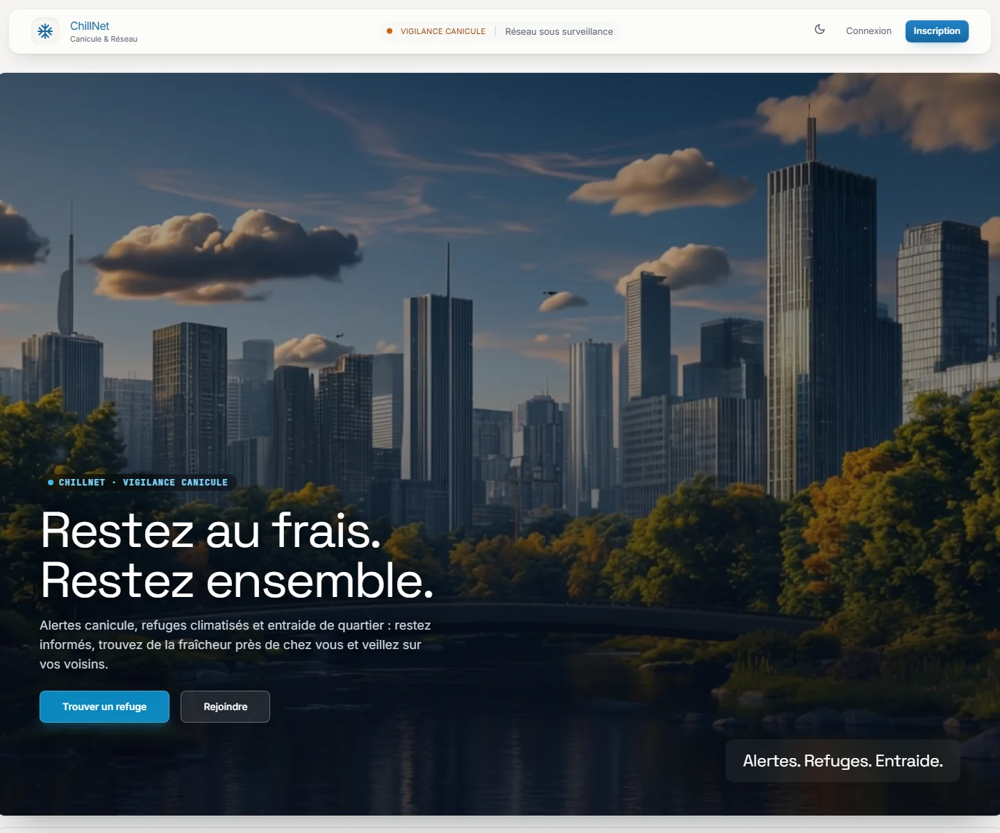
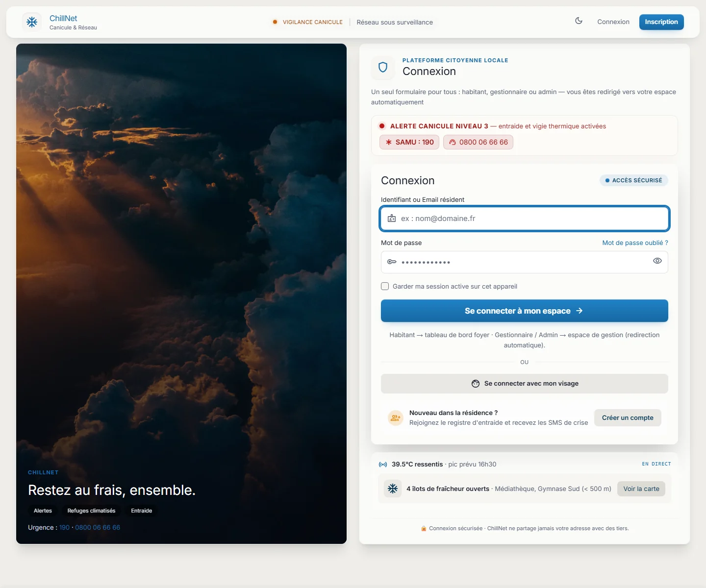
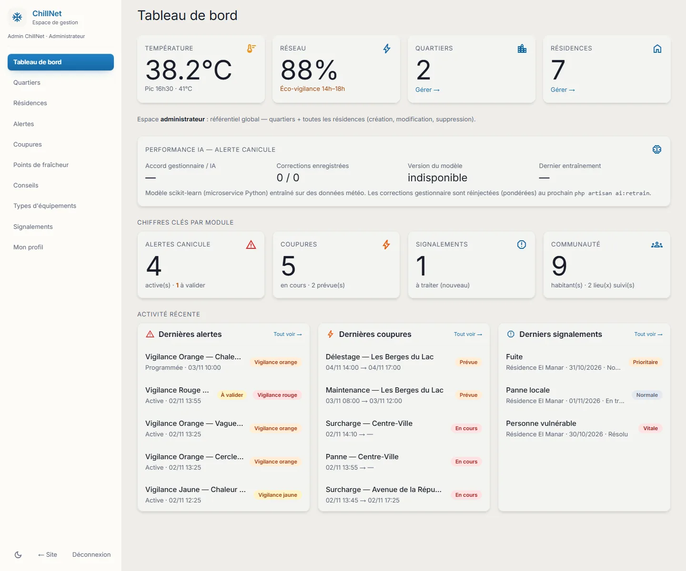
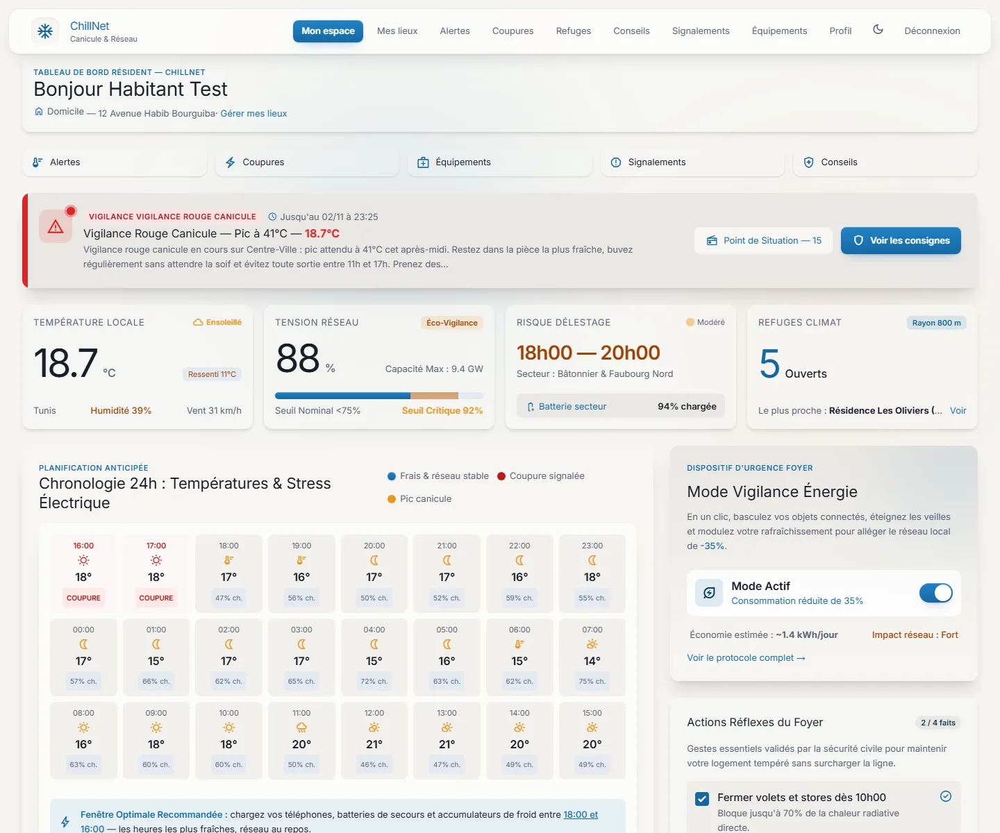

<p align="center">
  
</p>

<p align="center">
  
</p>

<p align="center">
  
  
  
  
</p>

## Overview

ChillNet is a citizen platform for heatwave vigilance and neighbourhood solidarity. Residents receive clear alerts, find air-conditioned refuges and fresh points nearby, and coordinate mutual aid during heat peaks. A dedicated machine-learning microservice predicts heat risk and explains its decisions to managers.

## Highlights

- Heatwave alerts with severity levels, geographic targeting and personalised messages
- Map of climate refuges, fresh points and community resources around the household
- Power-outage reporting and confirmation by residents
- Reports with PDF export and geolocation of every signalment
- Resident, manager and administrator roles with scoped dashboards
- Heat-risk prediction and explainability from a FastAPI + scikit-learn service

## Tech stack

<p align="center">
  
</p>

## Screenshots

<p align="center">
  <a href="docs/screenshots/landing.webp"></a>
  <a href="docs/screenshots/login.webp"></a>
  <a href="docs/screenshots/admin.webp"></a>
  <a href="docs/screenshots/habitant.webp"></a>
</p>

## Getting started

**Prerequisites:** PHP 8.2+, Composer, Node.js 20+, PostgreSQL (or SQLite for a quick local run), Python 3.11+ for the AI service.

```bash
composer install
npm install
cp .env.example .env
php artisan key:generate
# configure DB_* in .env, then:
php artisan migrate --seed
npm run build
php artisan serve

# AI microservice
cd ai-service
python -m venv .venv && source .venv/bin/activate
pip install -r requirements.txt
uvicorn app.main:app --reload --port 8001
```

## Project structure

```text
app/            Laravel domain (controllers, models, services, policies)
ai-service/     FastAPI + scikit-learn heat-risk service
database/       migrations and demo seeders
docs/           product and architecture notes
docker/         container definitions
jenkins/        CI/CD pipeline
k8s/            Kubernetes manifests
```

---

<p align="center">
  
</p>

<p align="center">
  Built by <a href="https://github.com/Skander-Bardaoui"><b>Skander Bardaoui</b></a> ·
  <a href="https://skander-bardaoui.netlify.app/">Portfolio</a> ·
  <a href="https://github.com/Skander-Bardaoui?tab=repositories">All repositories</a>
</p>
